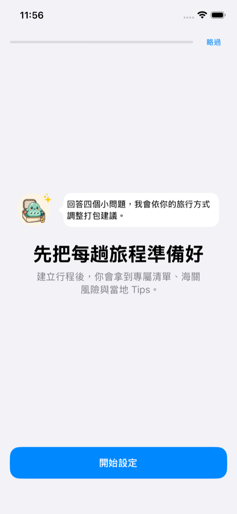
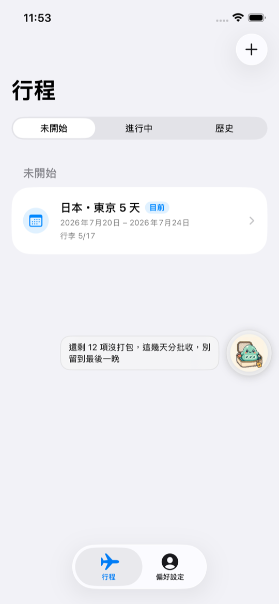
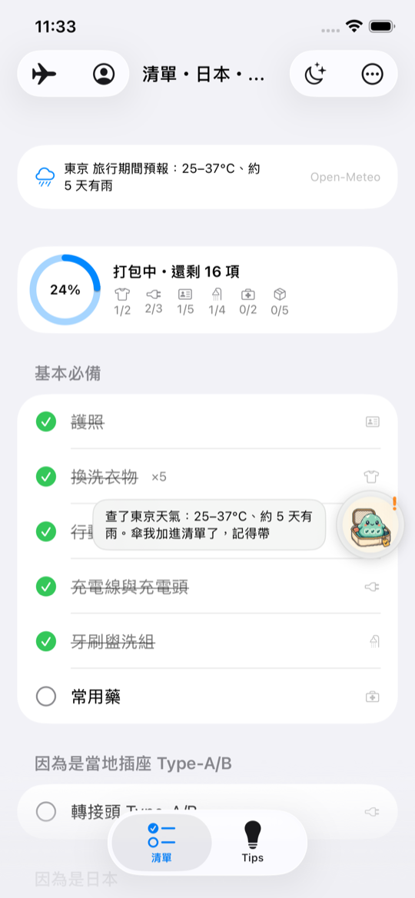
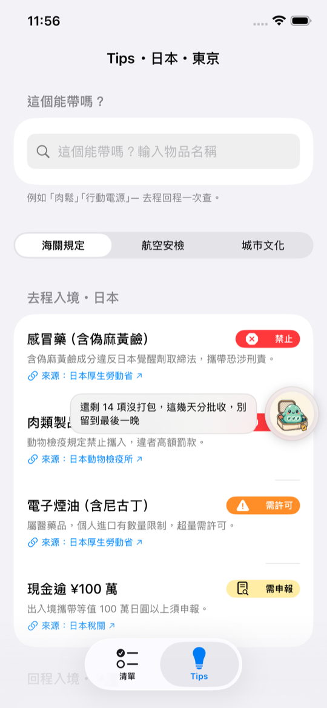

# Packmon — Your Travel Packing Partner

**Packmon** builds a personalized packing list from your destination, trip length, and travel style — and flags customs restrictions, airline-security limits, and local etiquette *before* you leave. Pack what you need; avoid what you can't bring.

🌏 **[Live landing page](https://packmon-travel.chenimin1006.chatgpt.site/)** · 🎓 **[Featured at Taiwan Student Creator Community](https://studentcreator.tw/apps/a84f05c8-07e2-42a6-b159-453096f51e32)**

📝 **[Take the 1-minute survey](https://iminstevenchen.github.io/packmon-web/survey/)** · 🌐 **[Web page](https://iminstevenchen.github.io/packmon-web/)**

> 📱 SwiftUI iOS app — iPhone version coming soon. This is a **public showcase**; the app source code is private.

<details>
<summary>繁體中文簡介</summary>

**Packmon（旅行打包夥伴）**：輸入目的地和旅程，產生專屬打包清單，並在出發前提醒海關禁帶、航空安檢和當地禮儀，每條規定都附官方來源和最後查證日期。吉祥物「小史萊姆」陪你打包。這是公開展示頁，App 原始碼為私有。

</details>

<p align="center">
  
  
  
</p>

## The problem

Generic packing checklists give everyone the same list and stop at "toothbrush, charger." They don't know your destination's customs rules, airline-security limits, or local culture — so travelers still get stopped at the border for something they didn't know they couldn't bring.

## What Packmon does

**🧳 Packs the right things** — A checklist generated for *this* trip: tailored to destination and weather, adjusted for travel style, with a clear reason attached to every item.

**🛂 Clears the border with confidence** — Customs rules shown as **Prohibited / Permit required / Must declare**, each with the reason, official source, and last-verified date — so a rule becomes an action, not just a warning.

**🌏 Knows the destination, not just the checklist** — Airline-security limits and city-specific culture and etiquette, all in one place before departure.

**🙂 Company for solo travelers** — "Packmon Jelly" tracks packing progress, shares practical travel trivia, and offers encouragement along the way.

## Personalized onboarding

Before generating a list, Packmon asks a few questions — age group, travel companions, prior travel experience, and packing style (light vs. thorough) — so the checklist is genuinely yours rather than a one-size-fits-all template.

<p align="center">
  
  
  
</p>

## Home-screen widgets

Two widget sizes surface departure date, destination, and live packing progress right on the home screen — a nudge toward "ready to go" every time you pick up your phone.

## Screenshots

<p align="center">
  
  
  
  
</p>

## Design belief

> "Simple can be harder than complex."

Real simplicity means understanding all the complexity *for* the traveler first — folding scattered packing info, customs rules, and travel reminders into steps that are easy to read and easy to act on.

## Team & my role

Built by **TravelGenius** (3 members) and showcased at the **Taiwan Student Creator Community**.

- **[I-Min (Steven) Chen](https://github.com/iminstevenchen)** — see my other work on my GitHub profile.

## Repository layout

```
.
├── README.md
└── assets/
    ├── screenshots/   App screenshots used above
    └── brand/         Mascot and brand images
```

This repository is a public showcase only. The app source code lives in a private repository.

---

*Packmon offers pre-trip preparation and reminders — it is not real-time legal or customs advice. Rules change; always confirm the latest official information before you travel.*

*© 2026 Packmon · Designed by TravelGenius in Taiwan*
